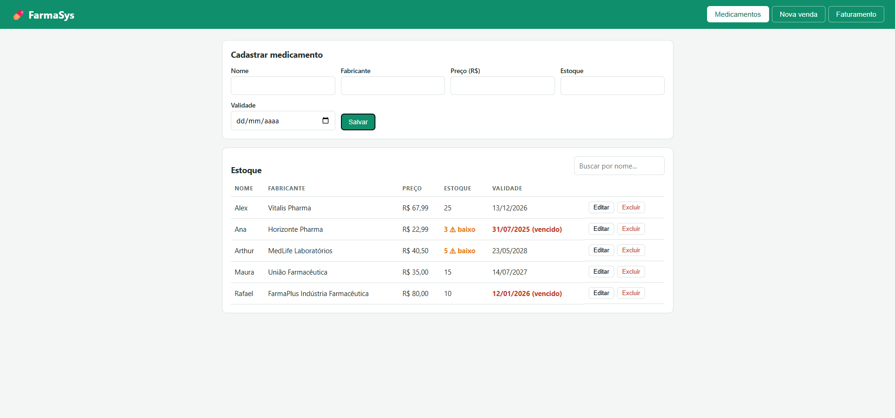
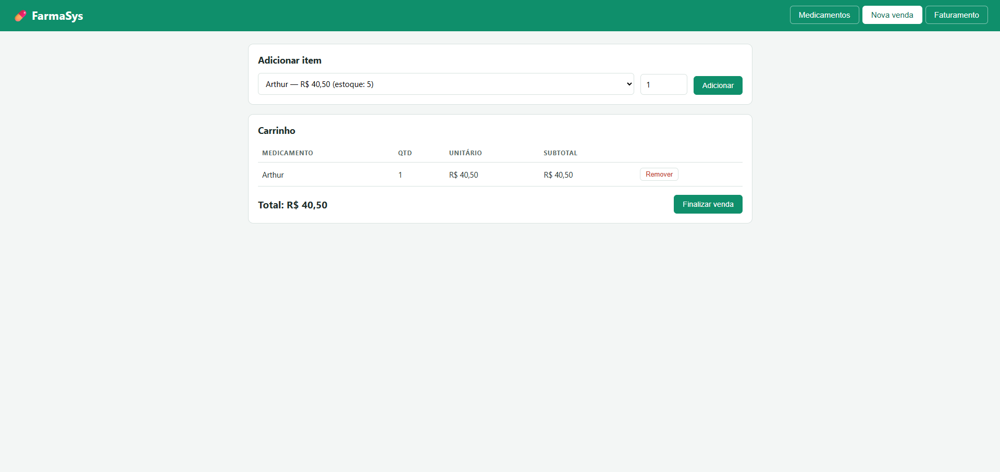
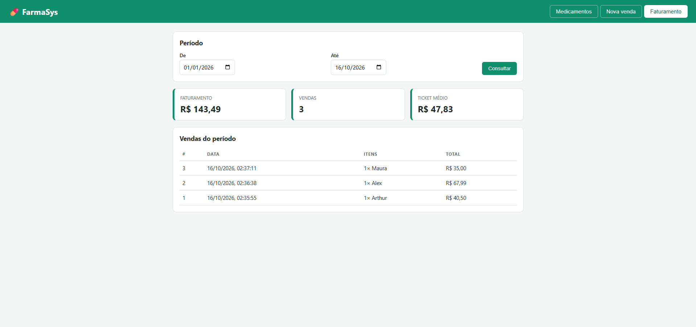

# 💊 FarmaSys – Sistema de Vendas para Farmácia


Aplicação web full stack para **cadastrar medicamentos, controlar estoque, registrar vendas e calcular o faturamento** de uma farmácia.

> Projeto desenvolvido para fins de estudo e portfólio.

## 📸 Telas

### Cadastro e controle de estoque


### Nova venda (carrinho)


### Faturamento por período


## ✨ Funcionalidades

- CRUD completo de medicamentos (nome, fabricante, preço, estoque e validade) com busca por nome
- Alerta visual de **estoque baixo** (menos de 10 unidades) e de **produtos vencidos**
- Venda com carrinho, com **baixa automática no estoque**
- Bloqueio de venda com estoque insuficiente ou medicamento vencido
- Faturamento por período: **total, quantidade de vendas e ticket médio**
- Histórico de vendas com os itens de cada uma

## 🧠 Decisões técnicas

- **Transação na venda:** a venda e a baixa de estoque acontecem na mesma transação (`@Transactional`). Se qualquer item falhar, nada é salvo.
- **Preço histórico:** o preço unitário é gravado no item da venda, então alterar o preço do medicamento depois não muda o histórico.
- **Validação nas duas pontas:** Bean Validation no back-end e checagens no front-end.
- **Tratamento global de erros:** `@RestControllerAdvice` devolve mensagens claras em JSON com o status HTTP adequado (400, 404, 409).
- **Segurança básica de front-end:** o conteúdo vindo do banco é escapado antes de ser exibido, evitando XSS.
- **Configuração por variáveis de ambiente:** nenhuma senha fica no código.

## 🛠️ Tecnologias

| Camada | Tecnologias |
|---|---|
| Back-end | Java 17, Spring Boot 3, Spring Data JPA, Bean Validation, Maven |
| Banco de dados | MySQL 8 |
| Front-end | HTML5, CSS3, JavaScript (fetch API) |

## 🗂️ Estrutura do projeto

```
src/main/java/com/farmacia
 ├─ model/        entidades JPA (Medicamento, Venda, ItemVenda)
 ├─ repository/   acesso ao banco de dados
 ├─ service/      regras de negócio (VendaService)
 ├─ controller/   endpoints REST
 ├─ dto/          objetos de entrada e saída
 └─ exception/    tratamento global de erros
src/main/resources/static   front-end (index.html, style.css, app.js)
database/schema.sql         modelo do banco e dados de exemplo
```

## 🚀 Como rodar localmente

**Pré-requisitos:** JDK 17+, Maven e MySQL 8 em execução.

1. Clone o repositório:
   ```bash
   git clone https://github.com/rafaelarcanjogarcia/farmasys.git
   cd farmasys
   ```
2. Informe a senha do seu MySQL por variável de ambiente (PowerShell):
   ```powershell
   $env:DB_PASSWORD="sua_senha"
   ```
   No Linux/macOS: `export DB_PASSWORD="sua_senha"`
3. Execute:
   ```bash
   mvn spring-boot:run
   ```
4. Acesse **http://localhost:8080**

O banco `farmacia` e as tabelas são criados automaticamente. O arquivo `database/schema.sql` é opcional e traz dados de exemplo.

**Variáveis disponíveis:** `DB_URL`, `DB_USER`, `DB_PASSWORD` e `PORT`.

## 🔌 Endpoints da API

| Método | Rota | Descrição |
|---|---|---|
| GET | `/api/medicamentos?busca=` | Lista e busca medicamentos |
| GET | `/api/medicamentos/{id}` | Busca um medicamento |
| POST | `/api/medicamentos` | Cadastra |
| PUT | `/api/medicamentos/{id}` | Atualiza |
| DELETE | `/api/medicamentos/{id}` | Exclui |
| POST | `/api/vendas` | Registra uma venda |
| GET | `/api/vendas?inicio=&fim=` | Lista vendas (período opcional) |
| GET | `/api/faturamento?inicio=&fim=` | Total, quantidade e ticket médio |

**Exemplo de venda:**
```json
POST /api/vendas
{
  "itens": [
    { "medicamentoId": 1, "quantidade": 2 },
    { "medicamentoId": 3, "quantidade": 1 }
  ]
}
```

## 🔮 Próximos passos

- [ ] Testes automatizados (JUnit e Mockito)
- [ ] Login e perfis de acesso (Spring Security)
- [ ] Cadastro de clientes
- [ ] Relatórios: mais vendidos e produtos próximos do vencimento
- [ ] Docker Compose para subir aplicação e banco
- [ ] Documentação da API com Swagger

## 👨‍💻 Autor

**Rafael Garcia**
[LinkedIn](https://www.linkedin.com/in/rafael-arcanjo-01740735a/) · [GitHub](https://github.com/rafaelarcanjogarcia) · rafaelarcanjogarcia@gmail.com
